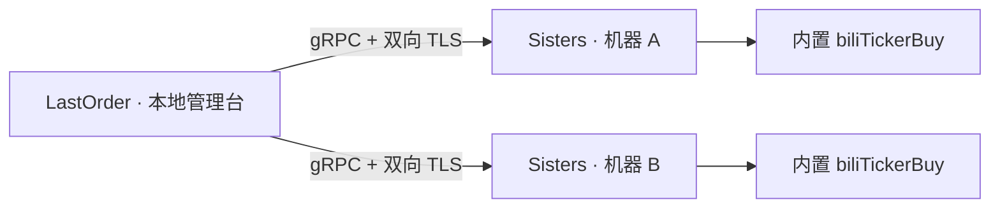

# MisakaNetwork

### 多台机器的抢票任务，一处管理。

在 LastOrder 中登录哔哩哔哩账号、选择演出场次，把任务交给不同机器上的 Sisters 执行。部署服务、分发任务、查看进度，都在同一个应用里完成。

MisakaNetwork 基于 biliTickerBuy，安装包内置抢票程序与运行环境，远程机器无需另装 Python 或 Go。

[快速开始](#快速开始) · [支持的平台](#支持的平台) · [功能](#功能) · [文档](#文档) · [版本记录](CHANGELOG.md)

目前处于早期研发阶段。[0.1.6](docs/releases/0.1.6.md) 已提供 macOS、Windows、Android 共五份完整测试包，并完成全平台统一核验。真实账号登录和下单仍待业务验收；请按版本记录确认安装与验证范围。

## MisakaNetwork 适合你吗？

如果你希望在多台机器上运行 biliTickerBuy，又想集中管理账号、场次和执行进度，MisakaNetwork 提供了这些能力：

- **集中部署**：录入机器连接信息，由 LastOrder 安装对应的 Sisters 服务，也能重新部署更新。
- **灵活分发**：一个任务可以交给多台机器，一台机器也可以接收多个任务。
- **统一查看**：在管理台查看各台机器的在线状态、任务进度和执行结果，按需停止任务。

LastOrder 提供 macOS、Windows 与 Android 管理台，执行任务的 Sisters 支持 macOS 和 Linux。实际安装包与已知限制见 [0.1.6 交付记录](docs/releases/0.1.6.md)。

## 快速开始

**1 · 安装 LastOrder。** 按系统与架构选择安装包。macOS 的 Apple 芯片使用 `arm64`，Intel 芯片使用 `amd64`（x64），解压后运行 `LastOrder.app`。Windows x64 完整解压 ZIP 后运行 `LastOrder/LastOrder.exe`，不要只复制 EXE。Android 通常选择 arm64 APK，通过系统安装器安装。

目前提供本地构建产物，尚无公开下载页。三端 0.1.6 测试包见 [交付记录与安装说明](docs/releases/0.1.6.md#本地交付产物)，自行构建见[打包与发布](docs/打包与发布.md)。Android 必须为 Android 16 或更新版本，通常选择 arm64 APK，通过系统安装器安装；APK 使用测试签名。Windows 包未作 Authenticode 签名。当前安装包尚未进行 Developer ID 签名与 Apple 公证，macOS 可能需要你在系统安全设置中确认应用来源。

**2 · 部署 Sisters。** 打开「机器管理」，添加远程机器的 SSH 地址、用户名和密码或私钥。核对首次连接显示的主机指纹，然后部署。LastOrder 会自动选择匹配系统与架构的完整部署包。

远程机器需要开启 SSH、具备运行用户服务的条件，并允许 LastOrder 访问 gRPC 端口，默认 `17443`；部署完成后会从本机直连检查一次，端口不通会提示放行防火墙。Linux 账号还需开启 linger（管理员执行 `sudo loginctl enable-linger <用户名>`），否则 SSH 断开后服务会被系统停止；部署时会检查，未开启会停止部署并提示。详细要求见[部署说明](docs/架构与通信.md#部署)。

**3 · 登录并创建任务。** 在「账号与任务」用哔哩哔哩手机客户端扫码登录，或导入 JSON Cookie 数组。输入演出 ID 或会员购链接，选择场次、票档、购票人和收货地址，填写联系人与电话。开售时间（北京时间）默认取所选票档的起售时间，可以修改，留空则分发后立即开始。购票人和地址需要先在哔哩哔哩账号中配置；当前电子票也需要选择收货地址。

**4 · 分发并查看结果。** 为任务选择一台或多台 Sisters，分发后在「任务监控」查看进度或停止任务。保存任务不会立即执行；分发后，Sisters 会等到开售时间再开始抢票。确认创建订单后，请前往哔哩哔哩订单页核对并支付。

## 支持的平台

| 模块 | 系统要求 | 架构 |
| --- | --- | --- |
| LastOrder 管理台 | macOS Sequoia 15.0 及以上 | Apple 芯片 arm64、Intel x64 |
| LastOrder 管理台（测试包） | Android 16（API 36）及以上 | arm64、x64 |
| LastOrder 管理台（测试包） | Windows 10 及以上 | x64 |
| Sisters 任务服务 | macOS Sequoia 15.0 及以上 | arm64、x64 |
| Sisters 任务服务 | Ubuntu 24.04 LTS 同代 Linux，glibc 2.39+ | arm64、x64 |

0.1.6 的全部 LastOrder 包均携带 Linux/macOS、arm64/x64 四种 Sisters 部署包。Windows Sisters 暂未实现；完整交付与验证范围见 [0.1.6 记录](docs/releases/0.1.6.md)。

## 整体结构

LastOrder 负责账号登录、场次选择、机器部署和任务管理；Sisters 在各台机器上调用 biliTickerBuy 执行任务，并将进度与结果返回管理台。

## 功能

### 部署一次，运行环境一起就绪

通过 SSH 密码或私钥连接机器，自动识别系统和架构，安装 Sisters、biliTickerBuy 和完整 Python 运行环境。远程部署无需再下载程序。更新时，在管理台选择「重新部署」即可安装随新版 LastOrder 提供的服务。

### 账号与场次，集中准备

支持扫码登录和 Cookie 导入，按演出读取场次、票档、购票人及收货地址，设置开售时间，再保存为可分发的任务。账号 Cookie 和含购票人信息的任务配置保存在各平台的系统安全存储中。

支持登录失效检测和原账号重新登录：平台明确判定失效后清除旧 Cookie，网络异常时保留凭据并暂停新任务分发。0.1.0 数据不迁移，需要重新配置。升级 0.1.6 后应重新部署 Sisters，并先核对旧任务和订单；使用过旧 Android 包导入私钥的设备还应清除应用缓存。具体操作见 [升级说明](docs/releases/0.1.6.md#升级影响与边界)。

### 多台机器，多项任务

同一任务可以分发给多台 Sisters，每台 Sisters 可以接收多个任务，并按并发上限排队执行。各台机器的执行结果分别展示；同一任务对每台机器只提交一次，Sisters 重启后再次分发也不会重复执行，需要重跑时请创建新任务。

### 进度与结果，随时查看

管理台每五秒同步机器状态和任务进度，支持手动刷新、查看执行结果及停止指定机器上的任务。连接中断时会保留最近一次状态并显示连接错误。

使用时请留意以下任务行为：

- 关闭 LastOrder、删除本地任务或移除机器记录，都不会停止远程执行；请在「任务监控」中停止任务。
- 一台机器成功后，其他机器上的任务不会自动取消，需要手动停止。
- Sisters 重启或重新部署会结束运行任务并清空任务记录；更新前请等待任务完成或先停止任务。
- 应用不会自动付款。当前尚未完成真实账号登录与下单验收，自动化测试不代表成功出票。

## 文档

| 文档 | 内容 |
| --- | --- |
| [LastOrder 操作说明](docs/LastOrder/0.1.0实现.md) | 机器管理、账号登录、创建任务与监控 |
| [Windows 与 Android](docs/LastOrder/Windows与Android.md) | Windows/Android 平台实现、使用边界与升级影响 |
| [Cookie 生命周期](docs/LastOrder/Cookie生命周期.md) | 0.1.1 的登录状态、重新登录与升级影响 |
| [Sisters 配置说明](docs/Sisters/0.1.0实现.md) | 服务配置、任务队列和运行方式 |
| [架构与通信](docs/架构与通信.md) | 连接要求、安全通信与任务行为 |
| [打包与发布](docs/打包与发布.md) | 构建完整安装包、校验和与签名说明 |
| [版本记录](CHANGELOG.md) | 已交付版本与开发中的改动 |

## 隐私

账号 Cookie 和含购票人信息的任务配置由系统安全存储加密保存：macOS 登录钥匙串、Windows 加密存储或 Android Keystore 支持的加密存储。分发任务时，所需凭据和配置通过双向 TLS 加密连接发送给你选择的 Sisters，再由 biliTickerBuy 访问哔哩哔哩完成任务。

远程任务运行期间，Sisters 在内存中使用凭据；管理台只接收任务状态与进度，不展示上游原始日志。SSH 密码仅用于本次部署，不会持久化保存。通信与存储细节见[架构与通信](docs/架构与通信.md)。

## 许可证

内嵌的 biliTickerBuy 遵循 **PolyForm Noncommercial 1.0.0**，仅限该许可证允许的非商业用途。发行包包含上游许可证与 Required Notice；当前源码的依赖版本见 [NOTICE](runtime/NOTICE.txt)，已交付包的版本以对应发布记录为准，许可证见[原许可证](runtime/vendor/biliTickerBuy/LICENSE)。
