# MisakaNetwork（御坂网络）新手使用指南

欢迎使用 **MisakaNetwork**！这份指南面向第一次接触本软件的用户，按顺序带你走完**安装 → 添加机器 → 登录账号 → 创建任务 → 分发抢票与付款**的全流程，并在后半部分简单介绍**公有云账号配置与一键创建云服务器**的进阶用法。

> 文中截图均来自 **LastOrder** 实际界面，示例中的账号、演出、地址与 IP（如 `203.0.113.x`）均为演示数据。

---

## 目录

- [一、30 秒看懂软件怎么工作](#一30-秒看懂软件怎么工作)
- [二、开始前的两件小准备](#二开始前的两件小准备)
- [三、基础流程：四步完成首次抢票](#三基础流程四步完成首次抢票)
  - [第 1 步：添加机器（部署 Sisters）](#第-1-步添加机器部署-sisters)
  - [第 2 步：登录哔哩哔哩账号](#第-2-步登录哔哩哔哩账号)
  - [第 3 步：创建抢票任务](#第-3-步创建抢票任务)
  - [第 4 步：分发任务、查看进度与付款](#第-4-步分发任务查看进度与付款)
- [四、进阶功能：公有云账号与一键创建云服务器](#四进阶功能公有云账号与一键创建云服务器)
  - [1. 配置公有云账号（录入并验证凭证）](#1-配置公有云账号录入并验证凭证)
  - [2. 创建云服务器、部署 Sisters 与用后释放](#2-创建云服务器部署-sisters-与用后释放)
- [五、新手常见问题](#五新手常见问题)

---

## 一、30 秒看懂软件怎么工作

软件由两部分配合完成抢票，你只需要打开一个界面即可全部掌控：

- **LastOrder（控制端）**：你下载并打开的图形软件。用来添加机器、登录 B 站账号、选好演出并查看进度。
- **Sisters（执行端）**：装在“负责抢票的电脑或服务器”上的后台程序。你**不需要**手动去下载或安装它，在 LastOrder 里添加机器时会自动装好。

打开 LastOrder 后，你会看到「工作台概览」首页，整体流程只有四步：**添加机器 → 登录账号 → 创建任务 → 分发并盯紧付款**。

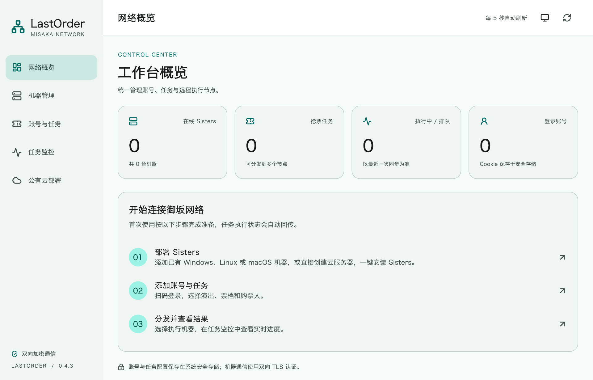

---

## 二、开始前的两件小准备

1. **安装并打开 LastOrder**
   - 前往 [GitHub Release 0.4.3](https://github.com/poppinzhang/MisakaNetwork/releases/tag/0.4.3) 下载对应系统的安装包（详细解压与系统安全提示处理见 [0.4.3 安装说明](releases/0.4.3.md#安装包)）：
     - **macOS（15.0+）**：Apple 芯片选 `arm64`，Intel 芯片选 `x64`，解压后打开 `LastOrder.app`。
     - **Windows（10 / 11 x64）**：**完整解压** ZIP 压缩包后，双击运行 `LastOrder/LastOrder.exe`（不要只把 `.exe` 单独拖出来）。
     - **Android（16+）**：通常下载 `arm64` APK 安装。
2. **先在哔哩哔哩手机 App 填好购票信息**
   - 打开手机上的哔哩哔哩 App → **会员购 → 我的**，提前添加好**常用购票人**和至少一个**收货地址**。
   - **特别注意**：即使你要买的是**电子票**，目前也必须在 B 站账号里至少保留一个收货地址，否则创建任务时会无法保存。

---

## 三、基础流程：四步完成首次抢票

### 第 1 步：添加机器（部署 Sisters）

抢票需要至少一台运行 **Sisters** 的电脑或服务器（支持 Windows 10+ x64、macOS 15.0+ 或 Ubuntu 24.04 同代及更新 Linux）。如果你手里**只有正在用的这台电脑**，直接把 Sisters 部署在**本机**就可以开始用！

1. 点击左侧菜单 **「机器管理」**，再点击右上角 **「添加机器」**。
2. 在弹出的 **「添加 Sisters」** 窗口中，按下方说明填写信息：

| 填写项 | 怎么填 |
| :-- | :-- |
| **机器名称** | 给机器起个好认的名字，例如 `本机电脑`、`家里台式机`。 |
| **主机地址** | 填写目标机器的 IP 地址或域名（不要带 `http://` 或 `ssh://`）。**如果部署在当前这台电脑，填写 `127.0.0.1`**。 |
| **gRPC 端口** | 保持默认 **`20001`** 即可。 |
| **SSH 用户名** | 目标电脑的系统登录用户名。 |
| **SSH 端口** | 保持默认 **`22`** 即可（除非目标机器改过 SSH 端口）。 |
| **SSH 密码 / SSH 私钥文件** | 二选一。密码仅用于本次安装，**软件不会保存你的密码**；如使用私钥文件且设了口令，再填下方「私钥密码」。 |

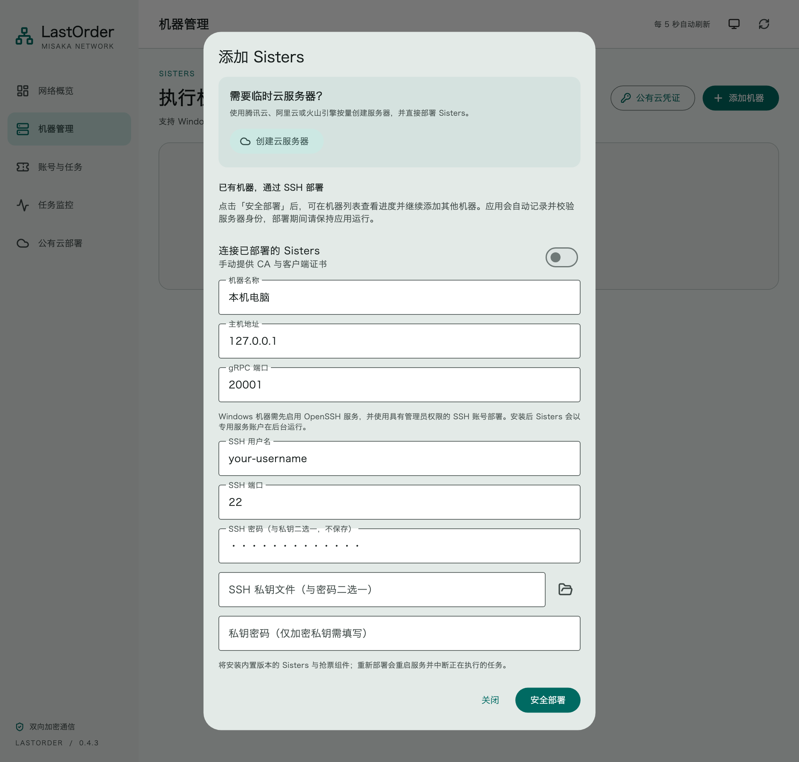

> **💡 小白必看：想把 Sisters 部署在「当前这台电脑（本机）」？**
>
> - **主机地址直接填 `127.0.0.1`**（它代表“这台电脑自己”），gRPC 端口填 `20001`，SSH 端口填 `22`。
> - 部署前，需要先打开本机的 **SSH 远程登录**开关：
>   - **macOS**：打开「系统设置 → 通用 → 共享」，开启 **「远程登录」**。SSH 用户名填你的 Mac 短用户名（不确定可打开「终端」输入 `whoami` 回车查看），密码填你开机解锁 Mac 的密码。
>   - **Windows（10 / 11 x64）**：需要先安装并启动系统自带的 **OpenSSH 服务器**，且必须使用**具有管理员权限**的用户名与**账号登录密码**（注意：不是 Windows Hello 的 4 位 PIN 码）。准备步骤见 [Windows 执行机器准备说明](Sisters/Windows支持.md#机器准备)。
>   - **Android 手机**：手机只能作为管理端使用，**不能填写 `127.0.0.1` 部署到手机本机**，需要填写你的电脑或云服务器的 IP。
> - **如果是局域网内另一台电脑或远程 Linux 服务器**：填对方的局域网 IP 或公网 IP，确保目标机器放行了 TCP `22` 和 `20001` 端口。若 Linux 部署时提示未开启后台常驻（linger），按提示在目标机器执行 `sudo loginctl enable-linger <用户名>` 后重试，详见 [部署环境要求](架构与通信.md#部署)。

3. 填写完成后点击右下角 **「安全部署」**。弹窗关闭后，LastOrder 会在后台自动上传安装包并完成配置，期间你可以继续添加其他机器。
4. 卡片会实时显示部署进度条；等状态变成绿色的 **「在线」**，这台机器就可以用来抢票了！（部署期间请保持 LastOrder 处于运行状态。）

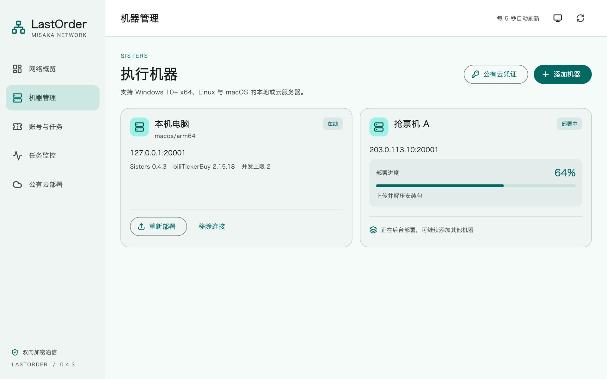

---

### 第 2 步：登录哔哩哔哩账号

1. 点击左侧菜单 **「账号与任务」**，在「登录账号」一栏点击右侧的 **「添加账号」**。
2. 弹窗打开后会自动生成二维码。打开手机上的 **哔哩哔哩 App 扫一扫** 并在手机上确认登录。
   - 软件每 2 秒会自动检查一次登录状态，确认后会自动保存并关闭窗口，**不需要**手动点击确认。
   - 如二维码过期，点击 **「重新生成二维码」** 即可。
   - *进阶备选*：如果你已有 `biliTickerBuy` 兼容的 Cookie JSON，也可打开弹窗顶部的 **「使用已有 Cookie」** 开关粘贴验证。

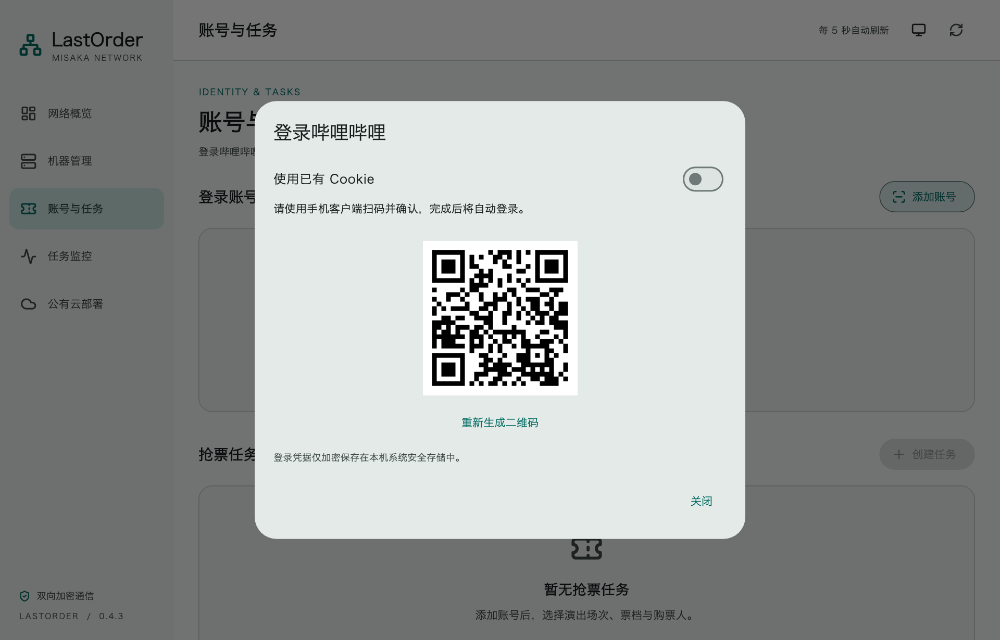

3. 登录成功后，账号卡片会显示 **「登录有效」**。如果日后提示登录过期，直接点击该账号卡片上的 **「重新登录」**，用**同一个 B 站账号**重新扫码即可，已建好的任务不用重做。

---

### 第 3 步：创建抢票任务

1. 在 **「账号与任务」** 页面的「抢票任务」一栏，点击右侧的 **「创建任务」**。
2. 先选择 **「使用账号」**，再填入 **「演出 ID 或会员购链接」**（直接把 B 站会员购演出页面链接粘贴进去，或只填链接末尾那串数字 ID 都可以），点击 **「读取演出与购票人」**。
   - 如果该演出按日期分开售票，会先让你选一个 **「场次日期」**，再点 **「读取场次」**。
3. 读取成功后，核对并填完下面几项：
   - **场次 / 票档**：下拉选择你想抢的场次与价位。
   - **开售时间（北京时间）**：默认会自动填好该票档的官方开售时间。可以点击时间按钮在日历里微调；如果你想**马上开抢**（例如抢回流票/捡漏），点击时间右侧的 **`×`** 清除时间即可。
   - **抢票请求间隔（毫秒）**：默认 `500` 毫秒（支持 `100`–`60000`），新手保持默认即可。
   - 开发中的版本在选择开售时间后还支持**开抢额外延迟（毫秒）**。这是在开售时间上加的一次等待，可以填写 `0`–`60000` 的整数，默认 `30`。例如 20:00:00 开售，填 `250` 表示从 20:00:00.250 起尝试。清除开售时间后直接开始。若分发时提示机器版本较旧，等已有任务结束后，在「机器管理」重新部署 Sisters。
   - **购票人**：勾选本次要购票的人员。姓名后会标注证件类型（如 `张三（身份证）`），方便区分同名购票人。
   - **收货地址、联系人与联系电话**：选好收货地址。当联系人和电话都为空时，**首次勾选购票人会自动帮你填入其姓名和电话**；如果平台隐藏了部分手机号，手动补全即可。
4. 确认无误后点击 **「保存任务」**。

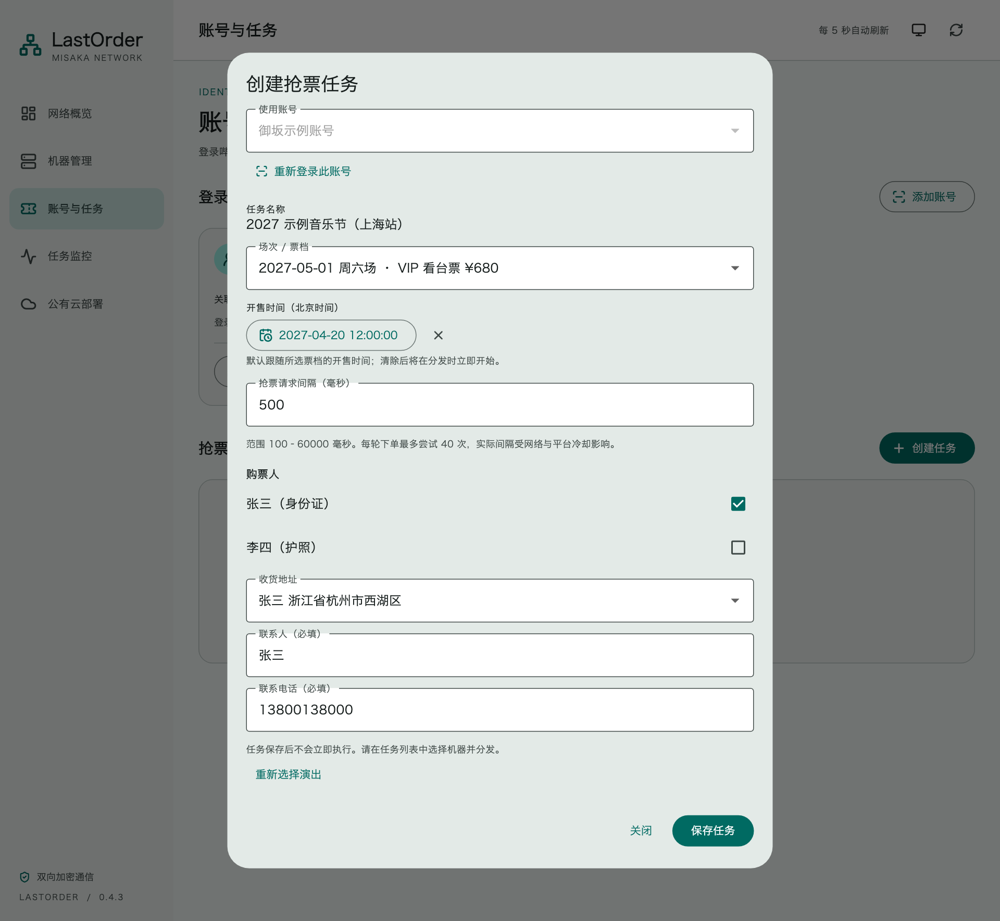

> **⚠️ 重要提醒**：点击「保存任务」只是把配置存下来，**还不会开始抢票**！必须完成第 4 步的 **「分发」**，机器才会真正执行。

回到 **「账号与任务」** 页面，你就能看到已登录的账号卡片和刚刚建好的任务卡片：
- 还没分发过的任务，可以点击卡片右下角的 **铅笔图标** 修改配置；
- 想复用已有配置（包括已分发过的任务），点击 **复制图标** 会生成一张全新的未分发副本。

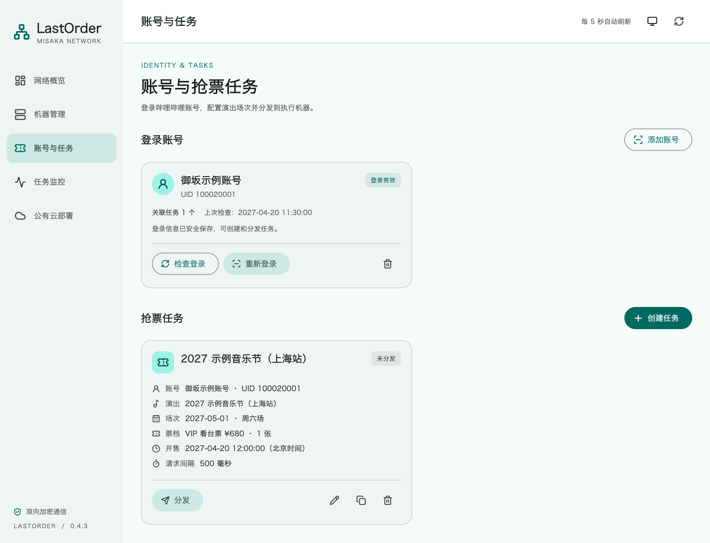

---

### 第 4 步：分发任务、查看进度与付款

#### 1. 分发任务到机器

1. 点击任务卡片左下角的 **「分发」** 按钮，打开分发窗口。
2. 核对顶部的开售时间，勾选一台或多台状态正常的机器（同一任务可以同时交给多台机器一起抢），点击右下角 **「提交到 N 台机器」**。
   - **避坑提示**：同一台机器同时跑多个抢票任务容易触发平台风控。如果某台机器上已经有正在执行或排队的任务，弹窗会显示其当前负载并在提交前弹出 **「多任务风险」** 提醒，建议优先选择负载为 `0` 的空闲机器。

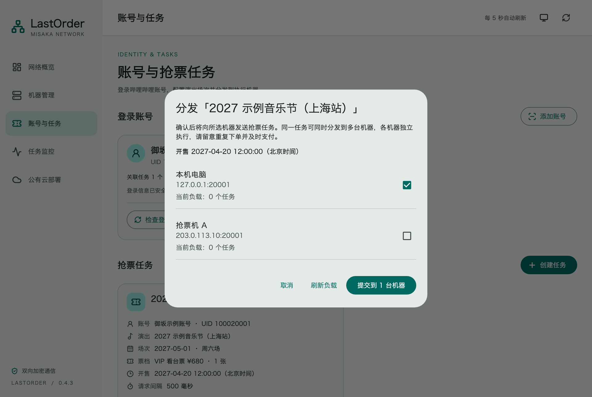

#### 2. 盯紧进度与付款

提交后会自动跳转到 **「任务监控」** 页面（页面每 5 秒自动刷新，也可点右上角刷新图标手动同步）：

- **查看进度**：设置了开售时间的任务会先进入「执行中」并等待到点开抢；点击卡片里的 **「展开消息」** 可查看机器最近的回报记录。
- **抢票成功与付款**：锁单成功后，页面顶部会出现 **「订单与付款」** 区域：
  - 点击 **「查看付款二维码」**，用对应支付 App 扫码核对金额并付款；
  - 或点击 **「打开订单详情」** 直接跳到 B 站会员购官方订单页付款（在手机端不方便扫自己屏幕，或二维码失效时推荐用此方式）。
- **手动停止与清理记录**：
  - 想中止某台机器的任务，点击该执行卡片右下角的 **「停止」**；
  - 已经结束（成功/失败/已停止）的旧记录，可以点单条 **「清除」** 或右上角 **「清除已结束记录」** 整理页面，不会删掉上方的订单入口。

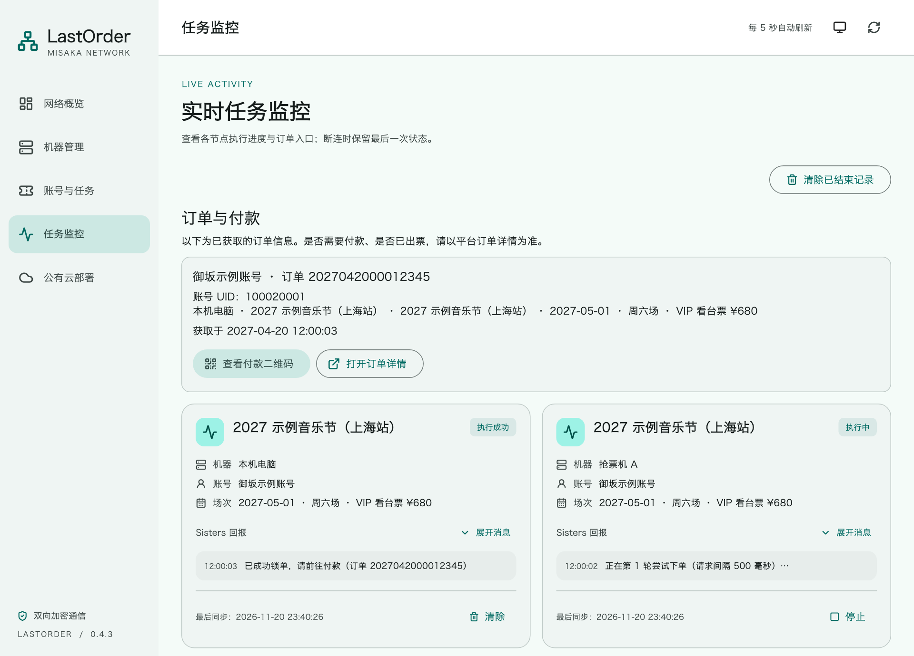

开发中的版本在右上角刷新按钮旁增加了「配置」。希望手机或电脑提醒付款时，可在这里打开「抢票成功通知」，并按系统提示允许通知。Android 分发任务后，在通知栏看到「正在监控抢票结果」就可以切换应用或锁屏。这条状态默认静默，只有执行机器确认本次抢到新订单时才提醒。如果手机长时间休眠或离线，重新打开 LastOrder 会立即查询结果。「配置」也可切换浅色、深色或跟随系统。

> **🛑 抢票期间必须牢记的三件事**
> 1. **本软件不会自动付款**：锁单后请尽快核对官方订单并在规定时间内支付。
> 2. **一台成功后，其他机器不会自动停止**：如果把同一任务发给了多台机器，请确认已锁单后，手动在「任务监控」点击其余机器的 **「停止」**。
> 3. **关闭 LastOrder 不会停止抢票**：Sisters 会在目标机器后台继续运行（电脑关机或休眠会中断）；只有点「停止」才会真正取消任务。

---

## 四、进阶功能：公有云账号与一键创建云服务器

如果你手里没有多余电脑，或者想在热门演出开抢前临时多租几台网络稳定的 Linux 云服务器、**抢完立刻销毁**（按小时和实际流量计费），可以直接使用内置的 **「公有云部署」** 功能。

目前支持三家国内主流云厂商的**按量计费**云服务器：**腾讯云（CVM）**、**阿里云（ECS）**、**火山引擎（ECS）**。

> **💰 费用与资源安全提醒**
> - 通过本功能创建的是你个人云账号下的**真实付费服务器**，费用由对应云厂商按量扣除。
> - **关闭 LastOrder 软件或移除本地连接，都不会释放云服务器或停止计费！** 使用完毕后务必回到应用内点击 **「释放云服务器」**，并到云厂商官网控制台核对状态与账单。

### 1. 配置公有云账号（录入并验证凭证）

使用前，你需要先去对应云厂商官网准备好账号与 API 访问密钥，再填入 LastOrder：

1. 点击左侧菜单 **「公有云部署」**（或在「机器管理」右上角点 **「公有云凭证」**）。
2. 在左侧选择一家云厂商（腾讯云 / 阿里云 / 火山引擎），填入对应的两项访问密钥，点击 **「联网验证并保存」**。
   - **不要填写网页登录密码**，也**不要直接使用云主账号密钥**；强烈建议按下方官方指引创建**专用子用户（CAM / RAM / IAM）**的 API 访问密钥。
   - 凭证联网验证通过后，会加密保存在本机系统安全存储中，**不会**发送给 Sisters。每家云厂商仅保存一份；如需更换，须先释放完该厂商名下未释放/待核实的云资源，再点 **「移除凭证」** 后重新录入。
3. 页面底部的 **「本机 SSH 登录密钥」** 会在软件首次启动时自动生成（显示 `已就绪`），创建云服务器时会自动把公钥导入云端，私钥始终留在你的本机，之后无需手输密码即可直接部署 Sisters。

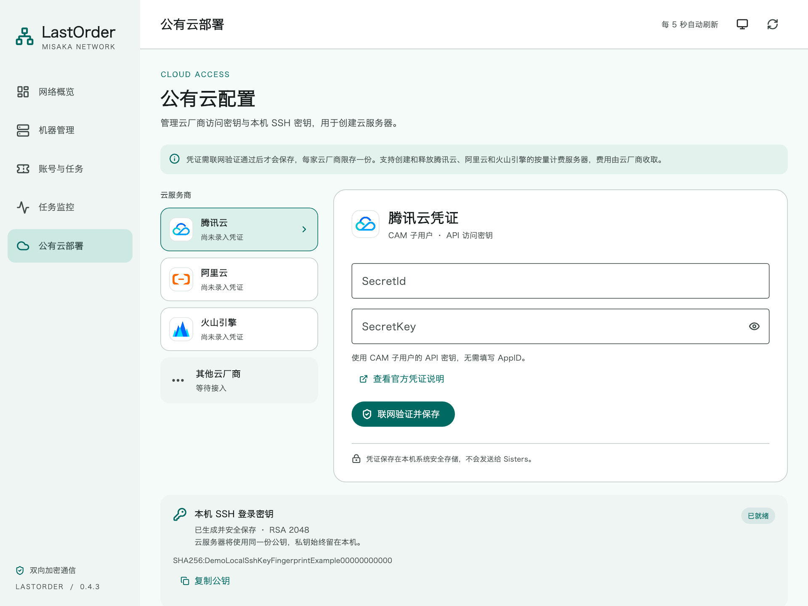

#### 各云厂商官方操作文档与所需权限参考

如果不熟悉如何在云平台开通按量付费、创建子用户或获取密钥，可直接查阅下方对应云厂商的官方文档：

| 云厂商 | 界面需填写的字段 | 开通、密钥与权限官方文档 | 子账号建议授权范围（简述） |
| :-- | :-- | :-- | :-- |
| **腾讯云（CVM）** | `SecretId` `SecretKey` | · [创建 CAM 子用户（用户类型）](https://cloud.tencent.com/document/product/598/13665) · [获取 API 访问密钥](https://cloud.tencent.com/document/product/598/37140) · [CVM 权限与可授权资源](https://cloud.tencent.com/document/product/213/10314) · [按量计费与使用限制](https://cloud.tencent.com/document/product/213/15379) | STS 身份查询；CVM 实例/镜像/密钥/可用区查询与创建/销毁；VPC、子网、安全组查询与创建（无需删除网络权限）。 |
| **阿里云（ECS）** | `AccessKey ID` `AccessKey Secret` | · [创建 RAM 用户 AccessKey](https://help.aliyun.com/zh/ram/user-guide/create-an-accesskey-pair) · [ECS 自定义权限策略指引](https://help.aliyun.com/zh/ecs/user-guide/custom-policies-for-ecs/) · [ECS 购买指引](https://help.aliyun.com/zh/document_detail/2859053.html) · [按量付费说明](https://help.aliyun.com/zh/ecs/pay-as-you-go-1) | STS 身份查询；ECS 实例/镜像/磁盘/密钥/安全组/库存查询与创建/释放；VPC、交换机查询与创建。 |
| **火山引擎（ECS）** | `Access Key ID` `Secret Access Key` *(注意：不是火山方舟 AI 模型的 API Key)* | · [IAM 访问密钥管理](https://docs.volcengine.com/docs/iam/api-access-key-management?lang=zh) · [ECS 购买与使用](https://docs.volcengine.com/docs/ecs/Buying-and-using-ECS-instances?lang=zh) · [按量计费说明](https://docs.volcengine.com/docs/ecs/pay-as-you-go?lang=zh) · [ECS API 与授权范围](https://docs.volcengine.com/docs/ecs/elastic-compute-service-api-overview?lang=zh) | STS 身份查询；ECS 实例/镜像/密钥/库存查询与创建/删除；VPC、子网、安全组及按量 EIP 查询与关联购买权限。 |

> 提示：云账号需先完成实名认证并满足对应云厂商的按量付费余额/配额要求（具体门槛与价格以各云厂商官网实时说明为准）。凭证通过「联网验证」只说明密钥身份有效，不代表权限、余额或机房库存已全部满足。

---

### 2. 创建云服务器、部署 Sisters 与用后释放

1. **进入创建向导**：在「公有云部署」验证完凭证后直接点击 **「创建云服务器」**，或在「机器管理 → 添加机器」弹窗顶部点击 **「创建云服务器」**。
2. **第 1 步（选择云厂商）**：点击已验证云厂商右侧的 **「创建」**。
3. **第 2 步（选择配置并确认）**：点击选中内置的服务器预设模板（如 `上海 2核2G Linux 服务器`），核对下方展示的地域、规格、系统盘、安全组端口（会自动放行 TCP `22` 与 `20001`）以及按量计费提醒后，点击 **「确认按量付费创建」**。
   - 如果首选机房（可用区）库存不足，应用会自动尝试同地域内其他有库存的可用区；网络、子网和安全组会自动创建或复用，无需手动配置。

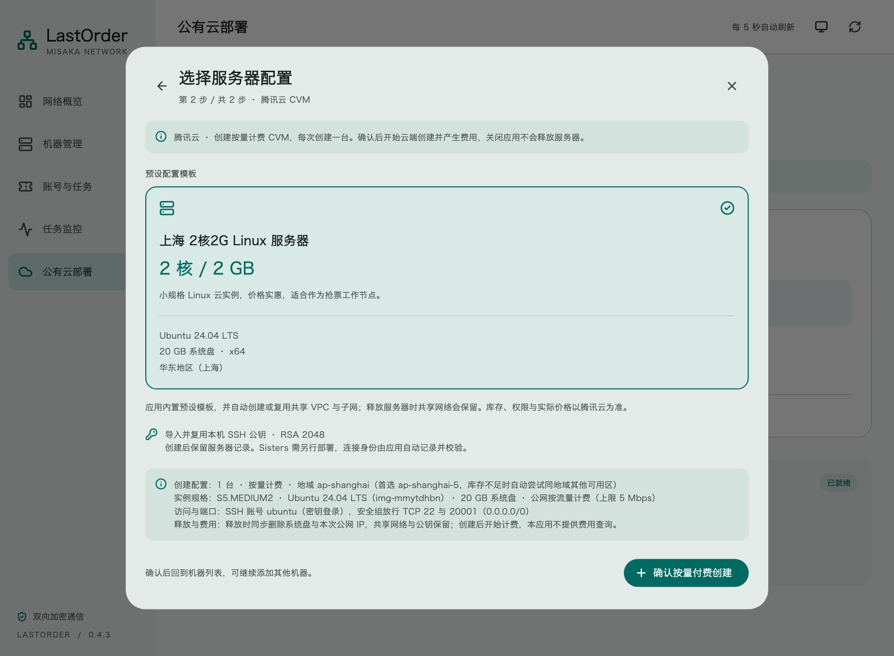

4. **一键部署 Sisters**：提交后会回到 **「机器管理」**。等待云端开机完成、卡片状态变为 **「已创建 · 待部署」** 且出现公网地址后，点击卡片上的 **「部署 Sisters」**。
   - 应用会自动用本机内置的 SSH 私钥完成安装。等下方出现 **「Sisters 执行节点 · 在线」** 后，就可以像普通机器一样在「账号与任务」里勾选它分发任务了！

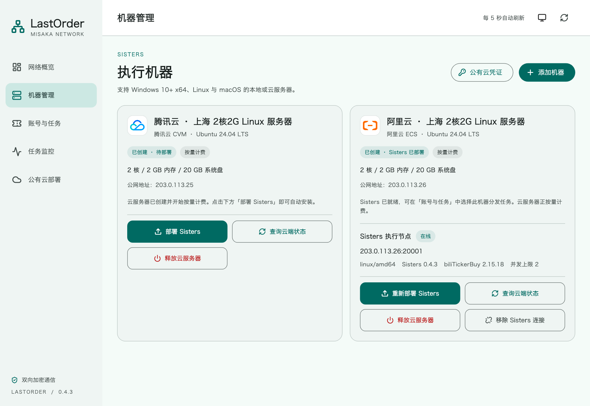

5. **抢完及时释放云服务器**：
   - 抢票结束后，回到 **「机器管理」**，点击该云服务器卡片上的 **「释放云服务器」** 并确认。
   - 云端确认销毁完成后，卡片会自动从列表移出（共享网络和公钥会保留方便下次秒复用，不再收取实例费）。
   - 如果创建过程中遇到断网、卡片停在 **「创建结果待核实」**，请先点击 **「查询云端状态」** 并登录云厂商官网控制台确认是否已生成实例，**不要盲目重复点创建**，避免多买多扣费。

---

## 五、新手常见问题

**1. 我创建好任务了，为什么一直没有动静？**
创建任务点击「保存任务」只是保存配置，不会自动开抢。你还需要到 **「账号与任务」**，点击该任务卡片左下角的 **「分发」**，勾选机器并提交。

**2. 抢票时可以把 LastOrder 关掉吗？**
可以。任务提交给 Sisters 后，抢票是在执行机器后台跑的，关闭 LastOrder 不会中断抢票；但要注意**执行机器本身不能关机、重启或休眠**。另外，因为需要手动扫码付款，开售前后建议保持 LastOrder 打开方便第一时间看到付款码。

**3. 部署本机（`127.0.0.1`）提示连接失败或认证被拒绝怎么办？**
按顺序排查这三项：
- 本机的 SSH 服务是否已经开启（macOS 共享里的「远程登录」 / Windows 的「OpenSSH SSH Server」服务正在运行）；
- SSH 用户名是否正确（在终端/命令行输入 `whoami` 核对）；
- SSH 密码是否正确（Windows 必须填账号登录密码，不能填开机 PIN 码，且该账号必须拥有管理员权限）。

**4. 读取演出后提示“账号未返回购票人”或“请先添加收货地址”？**
打开手机上的哔哩哔哩 App，进入「会员购 → 我的」，添加好常用购票人与收货地址，再回到 LastOrder 点击 **「重新选择演出」** 重新读取即可（电子票目前同样需要收货地址）。

**5. 以后 LastOrder 发布新版本，升级后要做什么？**
先核对已有订单，等正在执行的任务结束（或在「任务监控」手动停止），安装新版 LastOrder 后，到 **「机器管理」** 为每台机器点击 **「重新部署」**，把机器上的 Sisters 同步更新到同一版本即可。已登录的账号和保存的任务会自动保留，无需重配。
